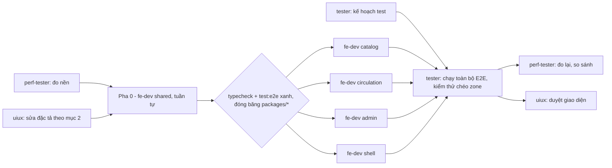

# Thiết kế phần dùng chung cho 4 zone (2026-11-15)

Người viết: sa. Người đọc: `fe-dev` (cả 4 người), `uiux`, `tester`, `perf-tester`, điều phối viên.
Đầu vào: [2026-11-15-ui-spec.md](2026-11-15-ui-spec.md) (mục 0, 4, 5, 6). Tài liệu này **ghi đè** đặc tả UI ở những điểm nêu trong mục 2; chỗ nào không nhắc thì giữ như đặc tả UI.

Đã đọc code thật: `packages/api/src/*`, `packages/ui/src/*`, `apps/shell/{proxy.ts,lib-zone-proxy.ts,lib-cookies.ts,next.config.ts}`, `apps/shell/app/api/{bff,session}/**`, `e2e/*`, `playwright.config.ts`; BE: controller nội bộ `services/*/infrastructure/web/*Controller.java`, `lms-api/.../web/{AuthController,ExternalAuthController,IdentityGatewayController,NotificationController}.java`, `lms-api/.../dto/AuthDtos.java`, migration `V9__roles_is_admin_va_permissions_theo_endpoint.sql`.

---

## 1. Bối cảnh và mục tiêu

- Đặc tả UI thay 3 trang chờ của zone bằng khoảng 20 màn hình, thêm trang cá nhân ở shell, chuông thông báo và chuyển đơn vị trong khung chung.
- Phần lớn thành phần mới nằm ở `packages/ui` và `packages/api`. Hai package này được nhúng ở mức source vào cả 4 app nên **mọi thay đổi ở đó buộc build và deploy lại cả 4 app**, và là nơi 4 người dễ sửa đè nhau nhất.
- Mục tiêu:
  1. Chốt API của các thành phần dùng chung **một lần**, trước khi 4 người làm song song.
  2. Sau pha chung, mỗi `fe-dev` chỉ sửa file thuộc zone mình (kể cả mock và spec E2E), không chạm `packages/*` trừ người được giao.
  3. Sửa các chỗ đặc tả UI giả định sai so với code thật (BFF, khóa quyền, đường dẫn tham số trả về của liên kết ngoài).

### Hiện trạng đã kiểm chứng trong code
- ✅ `Session` (`packages/api/src/session.ts`) chưa có `tenantId`. BE ký claim tên `tenantId` (xác nhận qua các test security của BE dùng `.claim("tenantId", ...)`).
- ✅ `@mfe/api` (`index.ts`) export cả `session.ts` và `gateway.ts`, mà hai file này import `next/headers`. **Client component không được import `@mfe/api`**; hiện chỉ có subpath `@mfe/api/config` an toàn.
- ✅ BFF (`apps/shell/app/api/bff/[...path]/route.ts`): `/api/bff/<x>` chuyển thành `${GATEWAY_URL}/api/<x>`; chỉ chép `Content-Type` của phản hồi, **không chuyển tiếp `Set-Cookie`**, không bắt lỗi khi gateway chết (fetch ném lỗi thì trả 500 trần), ghép `path.join("/")` từ các đoạn đã giải mã.
- ✅ `/api/session/refresh` chỉ có `GET` (redirect), không có dạng JSON để client gọi ngầm.
- ✅ `NavLink.permission` chỉ nhận `string`; `AppShell` lọc bằng `includes(l.permission)`.
- ✅ `proxy.ts` matcher: `/catalog`, `/circulation`, `/admin`, `/change-password`; chưa có `/profile`, `/notifications`.
- ✅ `e2e/mock-gateway.mjs` là một handler `if` tuần tự trong một file; `authorization.spec.ts` có test phụ thuộc nội dung trang `/admin` (bảng role, câu cảnh báo) và `/circulation` (chữ "Được phép"/"Không có quyền"); `zones.spec.ts` kiểm tiêu đề cố định "Danh mục sách", "Mượn trả sách", "Quản trị".
- ✅ Zone không khai báo `antd` trong `package.json` (lấy qua `@mfe/ui`).

---

## 2. Quyết định

### Q1. Thành phần dùng chung trong `packages/ui` và helper `bffFetch`

**Chọn: giữ khung của uiux nhưng bớt 3 thành phần, đổi hợp đồng 4 thành phần, và đặt helper client ở subpath mới `@mfe/api/client`.**

| Thành phần | Quyết định | Lý do |
|---|---|---|
| `StatusTag` | Giữ. Không có `"use client"` (dùng `Tag` đã re-export). Bỏ domain `fine` (chưa có endpoint phạt). Thêm giá trị tổng hợp `OVERDUE` cho domain `borrowing`; zone tự suy ra (ACTIVE và `dueDate` < hôm nay), `StatusTag` không tự tính ngày. | Thành phần thuần ánh xạ thì dễ test, không phụ thuộc giờ hệ thống. |
| `DataTable` | Giữ, đổi hợp đồng (mục 3.2): bỏ `rowHref` (cả dòng bấm được thì kém truy cập bàn phím), thay bằng cột `kind: "link"` + `href` dạng mẫu `"/catalog/books/{id}"`; phân trang server dùng tham số query `page` **đánh số từ 1 trên URL** (zone tự trừ 1 khi gọi BE), DataTable tự dựng href từ URL hiện tại, không cần `hrefTemplate`. Cho phép `render` tùy chọn **chỉ khi** DataTable được gọi từ client component. | `kind` giữ được nguyên tắc "server chỉ truyền props serialize được"; `render` tùy chọn tránh việc zone phải viết lại bảng chỉ vì một cột nút. |
| `ErrorPanel` | Giữ, là client component (`"use client"`), props `error: ErrorInfo`, `retryHref?`, `onRetry?` (chỉ dùng từ client), `messages?` (bảng mã lỗi riêng của zone). | Server truyền `ErrorInfo` (object thuần) và `retryHref`; client truyền thêm `onRetry`. |
| `NoPermission` | Giữ, **bỏ `permissionKey`**. | Quản trị viên (`admin=true`) luôn qua `can()` nên không bao giờ thấy `NoPermission`; hiện khóa "chỉ cho admin" là code chết. |
| `FormModal` | Giữ, đổi `onSubmit(values) => Promise<void>`: **ném lỗi** (`ApiCallError`) thay vì trả `{ok:false}`. FormModal bắt lỗi, hiện Alert và gắn `details` vào ô. | Cùng một kiểu báo lỗi với `bffFetch`, zone không phải bọc try/catch rồi đổi kiểu. |
| `ConfirmAction` | Giữ (mỏng, bọc `Popconfirm`), mặc định `cancelText="Không"`. | Chuẩn hóa văn bản 3.8 ở một nơi. |
| `SearchBar` | Giữ. Đổi `q` thì **xóa `page`** khỏi query. Dùng `useRouter`/`usePathname` của Next (tự xử lý basePath). | Tránh trang 5 của kết quả cũ khi lọc mới. |
| `ScanInput` | Giữ như đặc tả. | |
| `KeyValueList` | Giữ, mỏng: bọc `Descriptions items`, giá trị `null`/rỗng hiện "—". | |
| `CopyButton` | ⏭️ **Bỏ.** Dùng `<Text copyable>` của antd (prop `copyable` serialize được, có tooltip tiếng Việt theo locale). | Không viết lại thứ antd đã có. |
| `DateText` | ⏭️ **Bỏ**, thay bằng hàm thuần `formatDate`, `formatDateTime`, `formatMoney` trong `packages/ui/src/format.ts`, **cố định `timeZone: "Asia/Ho_Chi_Minh"`**. | Hàm dùng được cả trong server component lẫn trong `kind` của DataTable. Không cố định múi giờ thì SSR (múi giờ máy chủ) và client (múi giờ trình duyệt) ra chuỗi khác nhau, gây lỗi hydrate. |
| `error-messages.ts` | Giữ, đặt ở `packages/ui/src/error-messages.ts`, hàm `describeError(info, extra?)`. Bảng 0.5 vào đây trong pha chung; mã lỗi riêng của zone truyền qua `extra`, **không** sửa file chung. | Zone thêm mã mới mà không đụng package chung. |
| Re-export antd (`antd.tsx`) | Mở rộng một lần trong pha chung, gồm danh sách của đặc tả **cộng** những gì các mục 1-4 còn dùng: `Checkbox`, `Radio`, `TreeSelect`, `Popover`, `Breadcrumb`, `Collapse`, `Row`/`Col` nếu cần, và `dayjs` (DatePicker cần). Quy tắc: **zone chỉ import antd qua `@mfe/ui`**, kể cả trong client component. | Một bản antd duy nhất (ConfigProvider/App context dùng chung), không phải thêm `antd` vào `package.json` từng zone (tránh 4 người cùng sửa `package-lock.json`). |
| `Providers` | Bọc thêm `<App>` của antd trong `ConfigProvider`. | `App.useApp()` lấy `message`/`modal` theo theme. |

**Helper client: `@mfe/api/client` (file mới `packages/api/src/client.ts`, thêm vào `exports` của `packages/api/package.json`).**
- Chứa `bffFetch`, `ApiCallError`, `ErrorInfo`, `toErrorInfo`, `PERMISSIONS`, kiểu `ApiError`. Tuyệt đối không import `next/headers`, `next/navigation` hay `session.ts`.
- Phương án loại:
  - ❌ Thêm `bffFetch` vào `@mfe/api` (`index.ts`): client component import `@mfe/api` sẽ kéo `next/headers` vào bundle client và build lỗi.
  - ❌ Đặt `bffFetch` trong `@mfe/ui`: trộn lẫn tầng gọi API vào gói UI; `@mfe/ui` vẫn cần kiểu lỗi của API.
  - ❌ Mỗi zone tự `fetch`: bốn cách xử lý 401/403/lỗi mạng khác nhau.
- Hệ quả: `@mfe/ui` phụ thuộc một chiều vào `@mfe/api/client` (cho `ErrorPanel`, `NotificationBell`, `nav-links`). Thêm `"@mfe/api": "*"` vào `dependencies` của `packages/ui/package.json`. `@mfe/api` không bao giờ import `@mfe/ui`.

### Q2. `NavLink.permission` dạng any-of

**Chọn: `permission?: string | string[]`, nghĩa "có ít nhất một khóa".** Mảng rỗng hoặc không khai báo nghĩa là không cần khóa.

- Phương án loại:
  - ❌ Thêm trường riêng `anyOf?: string[]`: hai trường cùng nghĩa, phải định nghĩa thứ tự ưu tiên khi cả hai có mặt.
  - ❌ Hỗ trợ cả all-of / biểu thức: chưa có nhu cầu.
  - ❌ Bỏ kiểm quyền cho link `/circulation`: độc giả không có quyền nào cũng thấy link, vào trang chỉ gặp `Empty`.
- Tương thích ngược: giá trị JSON cũ trong `MFE_NAV_LINKS` (chuỗi đơn) vẫn hợp lệ.
- `nav-links.ts` dùng hằng số `PERMISSIONS` từ `@mfe/api/client` thay cho chuỗi literal (một nguồn khóa duy nhất).

### Q3. Chuông thông báo, chuyển đơn vị, Session, liên kết tài khoản ngoài

**3a. Chuông thông báo: client component `NotificationBell` trong `packages/ui`, gắn vào thanh trên của `ShellFrame`.**
- Tải phía client bằng `bffFetch("/api/notifications/me")` khi mount, khi tab hiện lại (`visibilitychange`) và mỗi 60 giây khi tab đang hiển thị. Lỗi: ẩn số, `Tooltip` "Không tải được thông báo".
- Phương án loại:
  - ❌ Tải trong `AppShell` lúc SSR: mọi trang của mọi zone chờ thêm một lượt gọi tới support-service; support-service chậm thì cả hệ thống chậm.
  - ❌ Chỉ đặt chuông ở shell: các trang zone (phần lớn thời gian làm việc) không có chuông.
- Số "chưa đọc": BE không có API đánh dấu đã đọc, nên đếm `readAt == null` sẽ **không bao giờ giảm**. Khuyến nghị: số trên chuông = thông báo có `readAt == null` **và** `createdAt` sau mốc "đã xem lần cuối" lưu ở `localStorage` (khóa theo `userId`); mở popover thì cập nhật mốc. ⚠️ Cần người dùng duyệt (câu hỏi mở 2).

**3b. Chuyển đơn vị: route shell mới `POST /api/session/switch-tenant`.**
- Body từ client: `{ tenantId: string }` (kiểm dạng UUID). Route đọc `lms_rt` **và** `lms_at` từ cookie, gọi `POST ${GATEWAY_URL}/api/auth/switch-tenant` với body `{tenantId, refreshToken}` **kèm `Authorization: Bearer <lms_at>`**, vì endpoint nội bộ `AuthController/switchTenant` mang `@AuthenticatedOnly` (đã xác nhận trong code BE). Thành công thì `setSessionCookies` rồi trả `{ok:true}`; lỗi thì trả nguyên status và body BE.
- Thiếu `lms_at` (hết hạn) thì trả 401; client (`bffFetch`-style) làm mới phiên rồi thử lại một lần (xem 3.1).
- Danh sách đơn vị: client tải `GET /api/me/tenants` **khi mở menu người dùng lần đầu**, không tải ở SSR. Mục "Chuyển đơn vị" chỉ hiện khi danh sách có từ 2 phần tử; tên đơn vị hiện tại hiện trong đầu menu.
- Phương án loại:
  - ❌ Client gửi refresh token: token nằm trong cookie httpOnly, client không đọc được; làm lộ ra là phá mô hình bảo mật.
  - ❌ Lưu `availableTenants` vào cookie khi login/refresh để hiện tên đơn vị trên thanh trên ở SSR: thêm cookie, dữ liệu dễ cũ, phải sửa 3 route session. Để sau nếu người dùng muốn tên đơn vị luôn hiện trên thanh trên (câu hỏi mở 3).
- `Session` thêm `tenantId?: string` (claim `tenantId`). `AppShell` truyền `tenantId` xuống `ShellFrame` để đánh dấu đơn vị hiện tại.
- Form login gửi `tenantCode`: ⏭️ ngoài phạm vi đợt này (cần BA duyệt).

**3c. Liên kết tài khoản ngoài (OIDC).**
- Kiểm code thật: ✅ BFF **không** chuyển tiếp `Set-Cookie` (chỉ chép `Content-Type`). Nếu gọi `GET /api/auth/me/external/{p}/link` qua BFF thì cookie `lms_ext` bị bỏ và callback sẽ trả 400 `INVALID_STATE`.
- Kiểm thêm phía BE (`identity-service/.../ExternalAuthController.java`):
  - Cookie `lms_ext` có `Path=/api/auth`, `HttpOnly`, `SameSite=Lax`.
  - Callback là `<publicBaseUrl>/external/<p>/callback`, mặc định `http://localhost:8080/api/auth`, tức **origin của BE**, không phải shell.
  - `returnUrl` phải là URL tuyệt đối có origin khớp chính xác danh sách cho phép của BE.
  - Kết quả trả về qua query: `?linked=<p>` hoặc **`?authError=<LÝ_DO>`**. Đặc tả UI ghi `?error=`, sai so với code.
- Hệ quả: dù BFF có chuyển tiếp `Set-Cookie` thì cookie vẫn nằm trên origin của shell, còn callback chạy trên origin của BE. Ở dev nó chạy được nhờ cookie không phân biệt cổng (`localhost:3000` và `localhost:8080`), nhưng khi deploy shell và BE khác host thì hỏng.
- **Chọn:** đợt này chỉ làm **xem danh sách và hủy liên kết** qua BFF (không cần cookie). **Ẩn nút "Liên kết"**. BFF giữ nguyên, không chuyển tiếp `Set-Cookie`.
- Khi cần liên kết thật (có IdP), làm phương án B:
  - Shell thêm `GET /api/session/external/[provider]/link`: trình duyệt điều hướng tới route này; route gọi BE kèm Bearer, chuyển tiếp **đúng** cookie `lms_ext`, rồi trả 302 tới `authorizationUrl`.
  - Shell thêm `GET /api/auth/external/[provider]/callback`: chuyển tiếp sang BE kèm cookie `lms_ext`, trả lại 302 cùng `Set-Cookie` xóa cookie.
  - BE đặt `AUTH_EXTERNAL_PUBLIC_BASE_URL=<SHELL_URL>/api/auth` và danh sách origin cho phép là origin của shell; IdP đăng ký redirect URI ở shell.
- Phương án loại:
  - ❌ BFF chuyển tiếp mọi `Set-Cookie`: BE (hoặc một lỗi cấu hình) đặt được cookie tùy ý trên origin của shell, kể cả trùng tên `lms_at`/`lms_rt`; và vẫn không giải quyết việc callback nằm trên origin khác.
  - ❌ Chỉ chuyển tiếp `lms_ext` qua BFF: cùng vấn đề khác origin, chỉ "chạy được" ở dev.

### Q4. Khóa quyền

- ✅ Đã xác nhận trong `services/circulation-service/.../BorrowingController.java`:
  - `POST /internal/borrowings/{id}/returns` là method **`returnBook`**.
  - `POST /internal/borrowings/returns` (trả theo mã vạch, lms-api chưa mở) là `returnCopy`.
  - Migration `V9` của BE seed `RETURN_BOOK` = `BorrowingController/returnBook` cho `POST /api/borrowings/{id}/returns`.
  - **Chốt: `PERMISSIONS.RETURN_BOOK = "BorrowingController/returnBook"`.** Giá trị hiện tại (`returnCopy`) là sai.
- ✅ Đã đối chiếu tên method trong controller nội bộ cho mọi khóa ở bảng dưới (TitleController, BookCopyController, ReservationController, UserController, ReaderProfileController, AccessControlController, DepartmentController, AuditLogController, AuthController).
- Đặt tên hằng: giữ `LIST_ROLES`, `BORROW_BOOK` (đang được `apps/*` và test dùng), sửa giá trị `RETURN_BOOK`, thêm phần còn lại theo mẫu `<ĐỐI_TƯỢNG>_<HÀNH_ĐỘNG>`. Không đổi tên hằng cũ để pha chung khỏi phải sửa file của zone.
- Không thêm hằng cho endpoint lms-api chưa mở (`returnCopy`, `reportLost`, `byReader`, `FineController/*`, `UserController/resetPassword`). Thêm khi BE mở.

### Q5. Chống xung đột khi 4 người làm song song

**Chọn: pha 0 tuần tự do một người làm (khuyến nghị chính người làm shell), gồm toàn bộ `packages/*`, hạ tầng BFF/session của shell và tái cấu trúc E2E. Sau đó đóng băng `packages/*` rồi mới chạy pha 1 song song. Mỗi zone có file mock và spec riêng.**
- Phương án loại:
  - ❌ Mỗi người tự thêm thành phần chung khi cần: 4 người sửa `packages/ui/src/index.ts`, `antd.tsx`, `mock-gateway.mjs` cùng lúc, chắc chắn xung đột, và API thành phần mỗi lúc một khác.
  - ❌ Một nhánh tích hợp liên tục cho `packages/*`: phức tạp hơn nhu cầu.

---

## 3. Thiết kế

### 3.1 `@mfe/api`

```
packages/api/src/
  config.ts        (giữ; không import next/*)
  permissions.ts   (sửa, xem 3.4)
  errors.ts        (MỚI; không import next/*) ErrorInfo, ApiCallError, toErrorInfo
  client.ts        (MỚI) export * từ config, permissions, errors + bffFetch
  session.ts       (sửa) thêm tenantId
  gateway.ts       (giữ GatewayError)
  index.ts         (thêm export errors)
package.json exports: ".", "./config", "./client"   <- thêm "./client"
```

Hợp đồng:
- `type ErrorInfo = { status: number; code?: string; message?: string; details?: string[] }`. Đây là object thuần, server component truyền được cho `ErrorPanel`.
- `class ApiCallError extends Error { status; code?; details? }`.
- `toErrorInfo(e: unknown): ErrorInfo`:
  - `GatewayError` (nhận diện theo `status` + `body`, không import gateway.ts) hoặc `ApiCallError`: lấy các trường tương ứng.
  - Lỗi mạng (`TypeError`): `{status: 503, code: "NETWORK"}`.
  - Lỗi khác: `{status: 500}`.
- `bffFetch<T>(path: \`/api/${string}\`, init?: RequestInit & { json?: unknown }): Promise<T>`:
  - `path` là **đường dẫn BE đầy đủ** (`/api/books?keyword=x`), giống tham số của `gatewayFetch`; helper tự đổi tiền tố `/api/` thành `/api/bff/`. Đường dẫn không bắt đầu bằng `/api/` thì ném lỗi ngay.
  - Có `json` thì gửi `JSON.stringify` kèm `Content-Type: application/json`.
  - 401: gọi `POST /api/session/refresh` **một lần**, dùng chung một promise cho các lời gọi đồng thời, rồi gọi lại. Vẫn 401 thì `location.assign("/login?next=" + encodeURIComponent(location.pathname + location.search))` rồi ném lỗi.
  - Không ok: ném `ApiCallError(status, body.code, body.message, body.details)`. Lỗi mạng: `ApiCallError(0, "NETWORK")`. 204: trả `undefined`.
  - Đoạn đường dẫn chứa dữ liệu người dùng (barcode, code quyền) do zone tự `encodeURIComponent` **từng đoạn**. Riêng code quyền (`AccessControlController/listRoles`) trong `DELETE /api/roles/{id}/permissions/**` thì giữ nguyên dấu `/`, vì BE nhận `/**` và Spring mặc định từ chối `%2F`.
- Quy ước cho trang server (ghi vào AGENTS.md của zone nếu cần): gọi `requireSession` **ngoài** `try`, vì `redirect()` hoạt động bằng cách ném lỗi; bọc `try` chỉ quanh `gatewayFetch`, lỗi thì `return <ErrorPanel error={toErrorInfo(e)} retryHref=... />`.

### 3.2 `@mfe/ui`

```
packages/ui/src/
  antd.tsx            (sửa) re-export mở rộng + App + dayjs + icon
  Providers.tsx       (sửa) bọc <App>
  format.ts           (MỚI) formatDate/DateTime/Money, timeZone cố định
  status-labels.ts    (MỚI) bảng 0.4 (bỏ fine, thêm borrowing.OVERDUE)
  StatusTag.tsx       (MỚI)
  error-messages.ts   (MỚI) describeError(info, extra?)
  ErrorPanel.tsx      (MỚI, client)
  NoPermission.tsx    (MỚI)
  DataTable.tsx       (MỚI, client)
  FormModal.tsx       (MỚI, client)
  ConfirmAction.tsx   (MỚI, client)
  SearchBar.tsx       (MỚI, client)
  ScanInput.tsx       (MỚI, client)
  KeyValueList.tsx    (MỚI)
  nav-links.ts        (sửa) any-of, dùng PERMISSIONS
  Nav.tsx             (sửa) lọc bằng canSeeLink, truyền tenantId
  index.ts            (sửa) export các thành phần trên
  -- pha 1, chỉ người làm shell --
  ShellFrame.tsx      (sửa) gắn NotificationBell + UserMenu vào thanh trên
  NotificationBell.tsx, UserMenu.tsx, TenantSwitchModal.tsx (MỚI, client)
```

Hợp đồng `DataTable` (client):
```
Column = {
  key: string; title: string; dataIndex: string | string[];
  kind?: "text" | "mono" | "date" | "datetime" | "money" | "status" | "bool" | "link";
  statusDomain?: StatusDomain;            // khi kind = "status"
  href?: string;                          // khi kind = "link": mẫu "/catalog/books/{id}", {field} lấy từ dòng
  width?: number; align?: "left" | "right" | "center";
  render?: (value, row) => ReactNode;     // CHỈ khi DataTable được dùng trong client component
}
Props = {
  columns: Column[]; rows: Record<string, unknown>[]; rowKey: string;
  empty: { title: string; hint?: string; action?: { label: string; href: string } };
  pagination?: { mode: "client"; pageSize: number }
             | { mode: "server"; page: number /* từ 1 */; pageSize: number; total: number; param?: string /* mặc định "page" */ };
  mobileTitleKey?: string; loading?: boolean;
}
```
- `kind: "link"` render `<a>` với đường dẫn đầy đủ (kể cả basePath). Không dùng `next/link`, vì Link trong package sẽ tự cộng basePath của zone và ra `/catalog/catalog/...`. Hệ quả là chuyển trang trong bảng là full page load (⚠️ hiệu năng, mục 5).
- Hiển thị trên điện thoại: nếu có `mobileTitleKey`, render **cả** bảng (`hidden sm:block`) và danh sách thẻ (`sm:hidden`) bằng CSS, không dùng `useBreakpoint`. Lý do: SSR không biết kích thước màn hình; dùng hook thì màn hình giật bố cục và lệch hydrate.
- Bảng lọc phía server mà rỗng: trang tự chọn nội dung `empty` theo việc có bộ lọc hay không (hai loại rỗng ở đặc tả 0.6). DataTable không tự đoán.

`ErrorPanel`: `{ error: ErrorInfo; retryHref?: string; onRetry?: () => void; messages?: Record<string, string> }`. 401 ở đây không redirect (server đã xử lý; client do `bffFetch` xử lý). Hiện "Phiên đã hết hạn" kèm link `/login`.

`NoPermission`: `{ feature: string }`, chỉ hiện `Result 403` như đặc tả 0.2.1.

`FormModal`: `{ open; title; okText; onCancel; onSubmit(values): Promise<void>; initialValues?; children; destroyOnHidden }`. Ném `ApiCallError` thì hiện Alert, còn `details` dạng `"field: msg"` thì gắn vào ô qua `form.setFields`.

### 3.3 `nav-links.ts` và `Nav.tsx`

```
export type NavLink = { href: string; label: string; permission?: string | string[]; group?: string };

export function canSeeLink(l: NavLink, s?: { admin?: boolean; permissions: string[] } | null): boolean
  // keys = permission == null ? [] : Array.isArray(permission) ? permission : [permission]
  // keys.length === 0 || s?.admin === true || keys.some(k => s?.permissions.includes(k))

DEFAULT_NAV_LINKS:
  "/"            Trang chủ   (không khóa)
  "/catalog"     Sách        BOOK_SEARCH
  "/circulation" Mượn trả    [BORROW_BOOK, RETURN_BOOK, RESERVATION_MINE]
  "/admin"       Quản trị    [LIST_ROLES, USER_SEARCH, DEPT_TREE, AUDIT_SEARCH]
```
- `getNavLinks` kiểm thêm: `permission` là chuỗi hoặc mảng chuỗi; sai kiểu thì dùng mặc định như hiện nay.
- `/profile`, `/notifications` **không** vào sidebar; chúng nằm trong menu người dùng và chuông.
- ⚠️ Môi trường nào đã đặt `MFE_NAV_LINKS` thì danh sách mặc định trong code **không** có hiệu lực; phải cập nhật giá trị env (cùng giá trị cho cả 4 app).

### 3.4 `permissions.ts` (chốt)

| Hằng | Khóa | Endpoint lms-api |
|---|---|---|
| `LIST_ROLES` (giữ tên) | `AccessControlController/listRoles` | GET /api/roles |
| `BORROW_BOOK` (giữ tên) | `BorrowingController/borrow` | POST /api/borrowings |
| `RETURN_BOOK` (**sửa giá trị**) | `BorrowingController/returnBook` | POST /api/borrowings/{id}/returns |
| `RENEW` | `BorrowingController/renew` | POST /api/borrowings/{id}/renewals |
| `BOOK_SEARCH` | `TitleController/search` | GET /api/books |
| `BOOK_VIEW` | `TitleController/get` | GET /api/books/{id} |
| `BOOK_CREATE` | `TitleController/create` | POST /api/books |
| `COPY_LIST` | `BookCopyController/list` | GET /api/book-copies?titleId |
| `COPY_ADD` | `BookCopyController/add` | POST /api/book-copies |
| `COPY_VIEW` | `BookCopyController/get` | GET /api/book-copies/{id} |
| `COPY_BY_BARCODE` | `BookCopyController/getByBarcode` | GET /api/book-copies/by-barcode/{barcode} |
| `COPY_CHANGE_STATUS` | `BookCopyController/changeStatus` | PUT /api/book-copies/{id}/status |
| `RESERVE` | `ReservationController/reserve` | POST /api/reservations |
| `RESERVATION_MINE` | `ReservationController/mine` | GET /api/reservations |
| `RESERVATION_CANCEL` | `ReservationController/cancel` | DELETE /api/reservations/{id} |
| `RESERVATION_EXPIRE` | `ReservationController/expireNow` | POST /api/reservations/expirations |
| `USER_SEARCH` | `UserController/search` | GET /api/users |
| `USER_VIEW` | `UserController/get` | GET /api/users/{id} |
| `USER_CREATE` | `UserController/create` | POST /api/users |
| `USER_UPDATE` | `UserController/update` | PUT /api/users/{id} |
| `USER_STATUS` | `UserController/changeStatus` | PUT /api/users/{id}/status |
| `CREDENTIAL_CREATE` | `AuthController/register` | POST /api/auth/credentials |
| `READER_VIEW` | `ReaderProfileController/get` | GET /api/users/{id}/reader-profile |
| `READER_ISSUE` | `ReaderProfileController/issue` | POST /api/users/{id}/reader-profile |
| `READER_RENEW` | `ReaderProfileController/renew` | PUT .../reader-profile/card-expiry |
| `READER_STATUS` | `ReaderProfileController/changeStatus` | PUT .../reader-profile/status |
| `ROLE_VIEW` | `AccessControlController/getRole` | GET /api/roles/{id} |
| `ROLE_CREATE` | `AccessControlController/createRole` | POST /api/roles |
| `ROLE_GRANT` | `AccessControlController/grantPermission` | POST /api/roles/{id}/permissions |
| `ROLE_REVOKE` | `AccessControlController/revokePermission` | DELETE /api/roles/{id}/permissions/** |
| `PERMISSION_LIST` | `AccessControlController/listPermissions` | GET /api/permissions |
| `PERMISSION_CREATE` | `AccessControlController/createPermission` | POST /api/permissions |
| `ACCESS_VIEW` | `AccessControlController/getUserAccess` | GET /api/access/users/{id} |
| `ACCESS_ASSIGN` | `AccessControlController/assignRole` | POST /api/access/users/{id}/roles |
| `ACCESS_REVOKE` | `AccessControlController/revokeRole` | DELETE /api/access/users/{id}/roles/{roleId} |
| `DEPT_LIST` | `DepartmentController/list` | GET /api/departments |
| `DEPT_TREE` | `DepartmentController/tree` | GET /api/departments/tree |
| `DEPT_VIEW` | `DepartmentController/get` | GET /api/departments/{id} |
| `DEPT_CREATE` | `DepartmentController/create` | POST /api/departments |
| `DEPT_UPDATE` | `DepartmentController/update` | PUT /api/departments/{id} |
| `DEPT_STATUS` | `DepartmentController/changeStatus` | PUT /api/departments/{id}/status |
| `AUDIT_SEARCH` | `AuditLogController/search` | GET /api/audit-logs |

- Không cần khóa (`@AuthenticatedOnly` ở controller nội bộ): `GET /api/borrowings/{id}`, `/api/users/me`, `/api/users/me/reader-profile`, `/api/notifications/me`, `/api/me/tenants`, `/api/auth/switch-tenant`, `/api/auth/password`, `/api/auth/me/external*`.
- ℹ️ `DepartmentStatus` của BE là `ACTIVE`/`INACTIVE` (đã xác nhận), khớp giả định ở bảng 0.4.
- ⚠️ Khóa dựa trên giả định của ADR-0003: lms-api chuyển tiếp tới đúng method nội bộ nêu trên. Tôi chỉ đối chiếu tên method nội bộ, chưa lần theo từng client HTTP của lms-api.

### 3.5 Shell: route mới và sửa đổi

| Route / file | Pha | Vào | Ra | Ghi chú |
|---|---|---|---|---|
| `app/api/session/refresh/route.ts` thêm `POST` | 0 | cookie `lms_rt` | 204 + đặt cookie mới, hoặc 401 + xóa cookie | Cho `bffFetch` làm mới phiên ngầm. Giữ nguyên `GET` và quy tắc chống open redirect. |
| `app/api/bff/[...path]/route.ts` | 0 | | | (1) `path.map(encodeURIComponent).join("/")` để `?`, `#`, `%` trong barcode không biến thành query. (2) `fetch` lỗi thì trả 502 `{code:"GATEWAY_UNAVAILABLE", message:"..."}`. (3) Giữ nguyên việc **không** chuyển tiếp `Set-Cookie`. |
| `app/api/session/switch-tenant/route.ts` | 1 | `{tenantId}` + cookie `lms_at`, `lms_rt` | `{ok:true}` + cookie mới; lỗi trả status BE | Gửi Bearer (BE `@AuthenticatedOnly`). |
| `proxy.ts` matcher thêm `/profile`, `/notifications` | 1 | | | Để token hết hạn thì làm mới phiên trước khi vào trang. Trang vẫn gọi `requireSession`. |
| `app/profile`, `app/notifications` | 1 | | | Trong shell dùng `next/link`, sang zone dùng `<a>`. |

Luồng gọi BE từ client sau thay đổi:
```
Trình duyệt (trang zone, qua shell :3000)
  └─ bffFetch("/api/books?keyword=x")
       └─ GET /api/bff/books?keyword=x ──► shell BFF ──Bearer(lms_at)──► GATEWAY /api/books ──► lms-api ──► catalog-service
            401? ─► POST /api/session/refresh (một lần, dùng chung) ─► thử lại ─► vẫn 401 ─► /login?next=...
```
Luồng chuyển đơn vị:
```
UserMenu (mở) ─► bffFetch("/api/me/tenants") ─► ≥2 đơn vị thì hiện "Chuyển đơn vị"
TenantSwitchModal ─► POST /api/session/switch-tenant {tenantId}
   shell ─► POST GATEWAY /api/auth/switch-tenant {tenantId, refreshToken=lms_rt}, Bearer lms_at
        ─► setSessionCookies ─► client: location.assign("/?switched=1")
```

### 3.6 E2E: tách mock và spec theo zone

```
e2e/
  mock-gateway.mjs     (pha 0) server, USERS, JWT, login/refresh/logout/password, dispatch tới các module
  mock/data.mjs        (pha 0) dữ liệu mẫu dùng chung: sách, bản sao, user, hồ sơ độc giả, đơn vị
  mock/common.mjs      (pha 0) GET đọc chéo zone: /api/books/{id}, /api/book-copies/{id},
                       /api/book-copies/by-barcode/{b}, /api/users?keyword, /api/users/{id},
                       /api/users/{id}/reader-profile
  mock/shell.mjs       (shell)       /api/notifications/*, /api/me/*, /api/users/me*, /api/auth/switch-tenant, /api/auth/me/external*
  mock/catalog.mjs     (catalog)     /api/books*, /api/book-copies* (phần còn lại)
  mock/circulation.mjs (circulation) /api/borrowings*, /api/reservations*
  mock/admin.mjs       (admin)       /api/users* (còn lại), /api/roles*, /api/permissions*, /api/access/*, /api/departments*, /api/audit-logs*
  helpers.ts           (pha 0) thêm user mới
  catalog.spec.ts, circulation.spec.ts, admin.spec.ts, shell.spec.ts   (mỗi zone một file)
```
- Hợp đồng module: `export function handle(ctx): boolean`. `ctx = { method, url: URL, body, caller, send(status, body), requireKey(key): boolean }`. `requireKey` tự gửi 401/403 rồi trả `false`. Thứ tự dispatch: `common` → `shell` → `catalog` → `circulation` → `admin`, nên `/api/users/me` rơi vào shell trước admin.
- User mới, thêm một lần ở pha 0 (giữ nguyên `admin`, `staff`, `member`, `newbie*` để test cũ không đổi):
  - `librarian`: các khóa catalog, circulation, cùng `USER_SEARCH`, `READER_VIEW`.
  - `reader`: `BOOK_SEARCH`, `BOOK_VIEW`, `RESERVE`, `RESERVATION_MINE`, `RESERVATION_CANCEL`.
  - `multi`: thuộc 2 đơn vị, dùng cho test chuyển đơn vị.
  - Claim của mọi user có thêm `tenantId`.
- Test hiện có phụ thuộc nội dung trang zone, pha 0 chuyển nguyên văn sang spec của zone, sau đó zone tự sửa:
  - Từ `authorization.spec.ts`: 3 test `/admin` (bảng role, câu cảnh báo) chuyển sang `admin.spec.ts`; test "trang mượn trả..." chuyển sang `circulation.spec.ts`.
  - `authorization.spec.ts` chỉ còn test thanh điều hướng; người làm shell sở hữu file này.
  - `zones.spec.ts`: bỏ kiểm tiêu đề cố định; chỉ kiểm trang trả 200, có `main`, asset `/<zone>-static` không lỗi. Nhờ vậy zone đổi tiêu đề không làm hỏng test hạ tầng.
- Trạng thái mock dùng chung cho 2 worker chạy song song: test **không** được giả định số lượng bản ghi; mỗi test dùng dữ liệu riêng (barcode, tên sách có hậu tố riêng) và không dựa vào việc test khác đã sửa dữ liệu.

---

## 4. Phân việc

### Thứ tự và phụ thuộc



### Pha 0: một `fe-dev` (khuyến nghị người sẽ làm shell), tuần tự
1. ⏳ `packages/api`: `errors.ts`, `client.ts`, `exports["./client"]`, `permissions.ts` (3.4), `Session.tenantId`.
2. ⏳ Shell: thêm `POST` vào `/api/session/refresh`; sửa BFF (encode từng đoạn, 502 khi gateway chết).
3. ⏳ `packages/ui`: các mục 3.2 trừ phần chỉ thuộc shell; `nav-links`/`Nav` any-of; `Providers` bọc `<App>`; dependency `@mfe/api` và `dayjs` (nếu cần) trong `packages/ui/package.json`. `package-lock.json` chỉ được sửa ở pha này.
4. ⏳ E2E: tách mock (3.6), thêm user, chuyển test, sửa `zones.spec.ts`.
5. ⏳ Cổng ra pha 1: `npm run typecheck`, `npm run typecheck:e2e`, `npm run test:e2e` đều xanh. Từ đây `packages/*`, `e2e/mock-gateway.mjs`, `e2e/mock/{data,common}.mjs`, `e2e/helpers.ts` bị đóng băng.

### Pha 1: 4 `fe-dev` song song, quyền sở hữu file

| Người | Được sửa | Không được sửa |
|---|---|---|
| catalog | `apps/catalog/**`, `e2e/mock/catalog.mjs`, `e2e/catalog.spec.ts` | mọi thứ khác |
| circulation | `apps/circulation/**`, `e2e/mock/circulation.mjs`, `e2e/circulation.spec.ts` | mọi thứ khác |
| admin | `apps/admin/**`, `e2e/mock/admin.mjs`, `e2e/admin.spec.ts` | mọi thứ khác |
| shell | `apps/shell/**`, `packages/ui/src/{ShellFrame,NotificationBell,UserMenu,TenantSwitchModal}.tsx`, `e2e/mock/shell.mjs`, `e2e/{shell,auth,password,authorization,zones}.spec.ts` | file chung khác trong `packages/*` |

- Cần đổi file chung (thêm re-export antd, thêm cột `kind`, thêm user mock, thêm dữ liệu vào `data.mjs`): gửi yêu cầu cho điều phối viên. Người làm shell (chủ `packages/*`) gom các yêu cầu và làm theo lô, sau đó **mọi zone** kéo bản mới về và build lại.
- Mã lỗi riêng của zone đưa vào `describeError(info, extra)` / `ErrorPanel messages`; không sửa `error-messages.ts`.
- Mỗi zone tự thêm `not-found.tsx`, `error.tsx`, `loading.tsx` của mình.
- Mỗi người làm trên git worktree/nhánh riêng. Thứ tự merge không quan trọng nếu tuân thủ bảng trên; nên merge shell trước nếu `ShellFrame` đổi, vì nó ảnh hưởng ảnh chụp giao diện của mọi zone.
- ⚠️ **Không chạy `test:e2e` đồng thời trên cùng một máy**: cổng 3000-3003, 3100, 8090 cố định và `reuseExistingServer: false`. Song song thì chỉ chạy `typecheck`/`build`; E2E chạy lần lượt (điều phối viên xếp hàng) hoặc giao cho tester.

### `uiux`
- ⏳ Trước pha 0: cập nhật đặc tả theo mục 2:
  - Bỏ `CopyButton`/`DateText`, bỏ `permissionKey` của `NoPermission`.
  - Đổi `?error=` thành `?authError=`; ẩn nút "Liên kết".
  - `bffFetch` nhận đường dẫn `/api/...`.
  - Phân trang URL đánh số từ 1.
  - Ngữ nghĩa "chưa đọc" của chuông.
- ⏳ Sau pha 1: duyệt giao diện các zone và chuông/menu người dùng.

### `tester`
- ⏳ Song song với pha 0: viết kế hoạch test theo từng zone. Gồm ma trận quyền (`admin`, `librarian`, `reader`, `member`, `staff`), 401 giữa phiên (refresh ngầm rồi thử lại), 403 sau khi đổi quyền, zone gọi thẳng cổng.
- ⏳ Sau pha 1: chạy toàn bộ E2E, kiểm thử chéo (catalog đặt trước rồi circulation thấy đặt trước; chuông có mặt ở mọi zone), kiểm chống open redirect còn nguyên ở `/api/session/refresh` (GET) và login.

### `perf-tester`
- ⏳ Trước pha 0: đo nền kích thước JS client từng zone, TTFB trang zone qua shell.
- ⏳ Sau pha 1, đo:
  - Thay đổi bundle do re-export antd mở rộng và `DataTable`.
  - Tải do chuông (mỗi người dùng 1 lời gọi/60 giây/tab).
  - N+1 lời gọi BE ở trang đặt trước và chi tiết phiếu mượn (lấy tên sách từng dòng).
  - Chi phí full page load khi bấm link trong bảng.

---

## 5. Rủi ro và việc chưa kiểm chứng

- ⚠️ **Sửa `packages/*` buộc build và deploy lại cả 4 app.** Pha 0 và mọi lô sửa chung về sau phải deploy đồng loạt. `ShellFrame` có chuông nên zone nào chưa deploy lại sẽ thiếu chuông (không lỗi, chỉ không đồng nhất).
- ⚠️ Client component import nhầm `@mfe/api` (thay vì `@mfe/api/client`) sẽ build lỗi vì `next/headers`. Nên ghi quy tắc này vào CLAUDE.md và AGENTS.md của từng zone.
- ⚠️ Open redirect: không đổi logic `next` ở `/api/session/refresh` (GET) và login. `bffFetch` chỉ chuyển tới `/login?next=<pathname+search hiện tại>`, luôn là đường dẫn cùng origin. `returnUrl` của liên kết ngoài (khi làm) phải do server dựng từ `SHELL_URL`, không lấy từ query.
- ⚠️ Zone gọi thẳng cổng của nó: vẫn phải `requireSession`. Ở cổng zone không có `/api/bff` (BFF chỉ ở shell), nên chuông và mọi `bffFetch` lỗi khi truy cập trực tiếp cổng zone. Chấp nhận được, vì người dùng chỉ đi qua shell.
- ⚠️ Đợt này không thêm zone mới nên `ZONES` và route handler không đổi; nếu sau này thêm thì vẫn phải sửa cả hai cùng lúc.
- ⚠️ CSS layer: thành phần mới **không** được tự import CSS antd hay đổi thứ tự layer; `<App>` trong `Providers` phải nằm **trong** `AntdRegistry layer`. Thành phần mới đặt trong `packages/ui/src` nên đã được `@source` quét.
- ⚠️ chưa kiểm chứng: `params.path` của catch-all trong Next 16 trả các đoạn **đã giải mã** (nên phải `encodeURIComponent` lại). Cần thử với barcode chứa `?`/`#`/`/` và code quyền chứa `/`.
- ⚠️ chưa kiểm chứng: BE có xoay vòng refresh token không. Nếu có, hai tab cùng làm mới phiên thì tab thua sẽ bị đẩy về `/login`. Promise dùng chung chỉ chống trùng trong một tab.
- ⚠️ chưa kiểm chứng: `/api/auth/switch-tenant` qua lms-api có giữ header `Authorization` tới identity-service không. Code lms-api chuyển tiếp bằng `AuthClient.switchTenant`; tôi chưa đọc client này.
- ⚠️ chưa kiểm chứng: re-export nhiều component antd từ một file `"use client"` có làm phình bundle client của trang chỉ dùng vài component không. perf-tester đo; nếu phình thì cân nhắc `optimizePackageImports` hoặc tách file re-export.
- ⚠️ Render cả bảng và thẻ (ẩn bằng CSS) làm text xuất hiện 2 lần trong DOM. Test nên khoanh locator trong `getByRole("table")` hoặc dùng role thay cho `getByText`.
- ⚠️ Chuông gọi mỗi 60 giây ở mọi tab, mọi zone; BE trả toàn bộ danh sách không phân trang. Người dùng có nhiều thông báo thì tốn băng thông. Đề nghị BE thêm `unread-count` và phân trang (đặc tả 6.9).
- ⚠️ Liên kết tài khoản ngoài phụ thuộc topology deploy (shell và BE cùng hay khác host) và cấu hình IdP: chưa rõ, xem câu hỏi 1.
- 🚫 Các màn trả theo mã vạch, danh sách phiếu mượn, phạt vẫn bị chặn bởi BE (đặc tả mục 6), không thuộc thiết kế này.

### Cần cập nhật CLAUDE.md / README.md (người dùng tự sửa, sa không sửa)
- ℹ️ `@mfe/api` có thêm subpath `@mfe/api/client` cho client component (`bffFetch`, `ApiCallError`, `PERMISSIONS`); client component không import `@mfe/api`.
- ℹ️ `@mfe/ui` phụ thuộc `@mfe/api/client`; zone chỉ import antd qua `@mfe/ui`.
- ℹ️ `NavLink.permission` nhận `string | string[]` (any-of); `nav-links.ts` dùng `PERMISSIONS` thay cho literal (README bảng biến môi trường `MFE_NAV_LINKS`, CLAUDE.md mục Phân quyền).
- ℹ️ `PERMISSIONS.RETURN_BOOK` = `BorrowingController/returnBook`.
- ℹ️ `/api/session/refresh` có thêm `POST` (JSON); có route mới `/api/session/switch-tenant`; matcher `proxy.ts` thêm `/profile`, `/notifications`.
- ℹ️ Mock E2E tách theo module `e2e/mock/*.mjs`, có thêm user `librarian`, `reader`, `multi`; số test thay đổi (CLAUDE.md và README đang ghi "22 test").

### Câu hỏi mở cho người dùng (kèm khuyến nghị)
1. **Liên kết tài khoản ngoài:** đợt này chỉ làm xem/hủy liên kết và ẩn nút "Liên kết" được không? Khuyến nghị: **có**. Làm đầy đủ cần cấu hình IdP và đổi `AUTH_EXTERNAL_PUBLIC_BASE_URL` của BE sang origin của shell (phương án B ở Q3c).
2. **Số "chưa đọc" trên chuông:** BE chưa có API đánh dấu đã đọc. Dùng mốc "đã xem lần cuối" lưu ở trình duyệt (mất khi đổi máy) được không? Khuyến nghị: **có**, đồng thời đề nghị BE thêm `POST /api/notifications/{id}/read` và `unread-count`.
3. **Tên đơn vị hiện tại:** chỉ hiện trong menu người dùng (tải khi mở menu) hay luôn hiện trên thanh trên (phải thêm cookie lưu tên đơn vị lúc login/refresh)? Khuyến nghị: **chỉ trong menu** ở đợt này.
4. **Link "Sách" trong sidebar** yêu cầu `TitleController/search`: tài khoản không có khóa này sẽ không thấy link. Đồng ý không? Khuyến nghị: **có**, cho khớp với `NoPermission` của trang.
